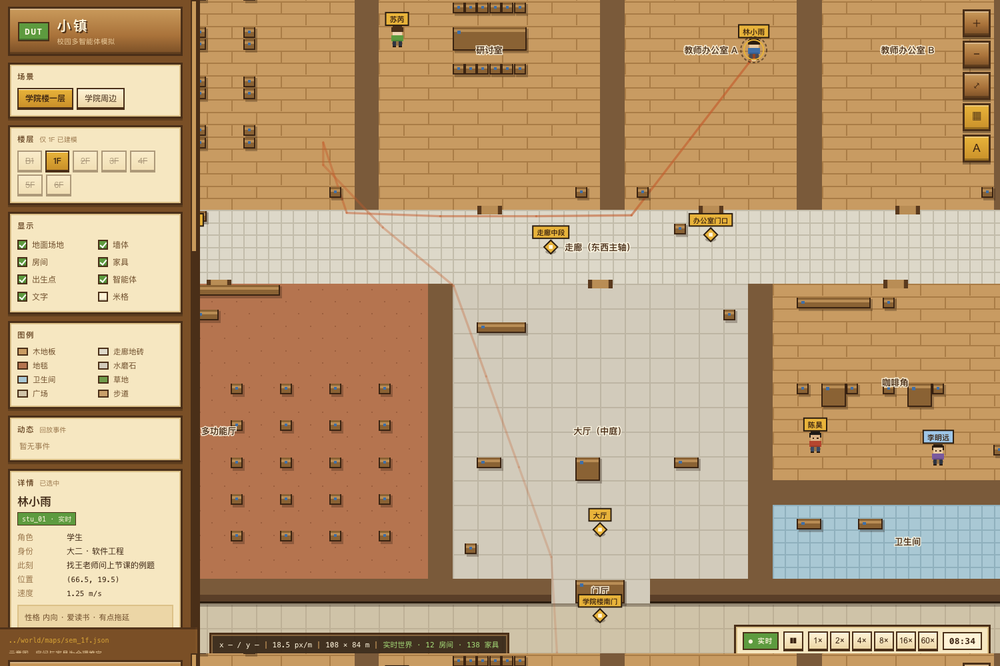
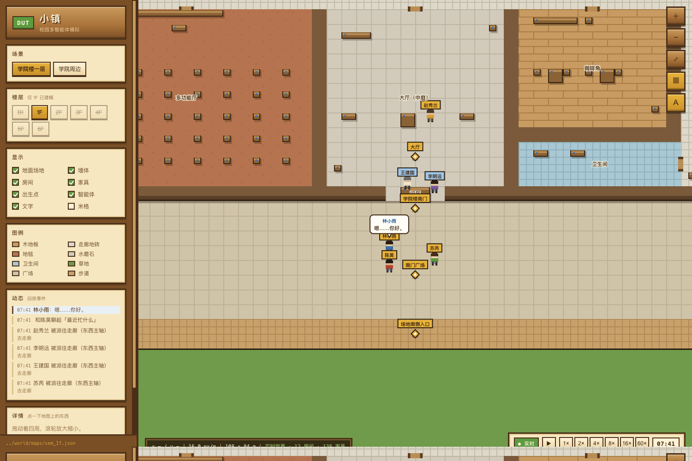

# DUT 小镇

校园多智能体社会模拟。目标是在一个模拟的大学校园里，部署一批由大语言模型驱动的智能体，让它们自主安排日程、自由移动、相遇交谈、形成记忆与社交关系，并提供可视化系统观察整个校园的运行。

完整设计见 **[DUT小镇项目设计文档.md](DUT小镇项目设计文档.md)**。



*选中某个智能体时，会画出他这一段的**空间轨迹**（由淡转浓＝由早到晚）。左侧面板是他的人格、关系、记忆与人格变化曲线。*



*两个智能体碰上会自己聊起来，头顶冒气泡；聊完各自写一条摘要记忆，并更新关系与人格。*

---

## 当前进度

| 阶段 | 内容 | 状态 |
| --- | --- | --- |
| **地图 v0.2** | 经济管理学院楼一层（室内）+ 南门小广场，星露谷风格 Web 查看器，家具层 | ✅ 已完成 |
| **地图 v0.1** | 学院楼及周边（300×212m 场地级） | ✅ 保留为第二个场景 |
| **M1 世界引擎** | tick 时钟、A\* 寻路、事件总线、回放轨迹 | ✅ 已完成 |
| **智能体精灵** | 6 个师生后勤智能体，像素精灵 + 走路动画 + 时间轴回放 + 事件流 | ✅ 已完成（大脑是规则占位） |
| **实时世界服务** | FastAPI + WebSocket 常驻世界，暂停/调速实时生效，可点地图干预个体 | ✅ 已完成 |
| **认知层 v0.2** | 记忆流 + 相遇对话 + **反思** + 人格漂移 + **SQLite 持久记忆** | ✅ 已完成 |
| **可视化** | 对话气泡、内心世界面板、**人格变化曲线**、**空间轨迹** | ✅ 已完成 |
| 切真实模型 | `config.json` 改一行即可；需要 API Key 或本地 Ollama | ⬜ 待你配 Key |
| 可视化 v0.3 | 关系网络演化图 | ⬜ 未开始 |
| M2 认知 | 记忆流、反思、计划、对话、师生角色卡（替掉占位大脑） | ⬜ 未开始 |
| M3 可视化 | 气泡对话、关系网络、地图编辑器 | ⬜ 未开始 |

**为什么先做一层楼**：师生互动（走廊偶遇、办公室答疑、教室上课）最密集的场所就是学院楼内部。先把一个 108×84m 的室内场景做深，比摊开整个校园更容易做出真实互动。

---

## 快速开始

```bash
# 起实时世界服务（FastAPI + WebSocket，静态资源也一起伺服）
python -m server

# 浏览器打开
open http://127.0.0.1:8123/web/
```

没有后端时的降级：`python tools/serve.py` 只伺服静态文件，页面会自动退回**回放模式**（播放 `saves/` 里的轨迹）。两条路都能看，区别只是能不能干预。

### 实时模式能做什么

| 操作 | 怎么做 |
| --- | --- |
| 暂停 / 继续 | 控制条左边第一个按钮 |
| 改时间流速 | 1× / 2× / 4× / 8× / 16× / 60×（游戏秒 ÷ 真实秒），实时生效 |
| 派人去某处 | 点一个小人 → 「派他去某处」→ 点地图上的落点（Esc 取消） |
| 让他停下 | 点小人 → 「让他停下」 |
| 看他在干什么 | 点小人，详情面板显示当前目标、位置、行走距离、路径（选中时地图上画出剩余路径） |
| 看刚发生了什么 | 左栏「动态」实时事件流 |

### 后端接口

```bash
curl http://127.0.0.1:8123/api/health          # 心跳 + 运行统计
curl http://127.0.0.1:8123/api/state           # 当前世界快照
curl http://127.0.0.1:8123/api/hello           # 人设 + 最近事件（客户端握手用）
curl -X POST http://127.0.0.1:8123/api/command -H 'Content-Type: application/json' \
     -d '{"cmd":"dispatch","agent":"stu_01","x":78,"y":46,"why":"去买杯咖啡"}'
```

WebSocket `ws://127.0.0.1:8123/ws`：服务端以 20 Hz 推状态，客户端发同样的指令。
REST 与 WebSocket 走的是**同一条 `WorldService.apply()` 路径**，所以指令行为完全一致、也便于测试。

**操作**：拖动平移 · 滚轮/双击缩放 · 点选房间或家具看属性 · 右上角按钮切网格与文字 · 左栏切场景和楼层。

**视图深链**（便于分享机位、也便于自动化截图）：

```
http://127.0.0.1:8123/web/?map=sem_1f&z=28&cx=21&cy=20
                            │          │   │    └ 视野中心 y（米）
                            │          │   └───── 视野中心 x（米）
                            │          └───────── 缩放 px/m
                            └──────────────────── 场景 id
```

## 地图校验与出图

```bash
# 跑一段模拟，导出回放轨迹（Web 查看器会自动加载它）
python tools/simulate.py --minutes 40 --out saves/demo_1f/trace.json

# 跑测试（寻路不穿墙 / 轨迹不越界 / 引擎可复现）
python -m pytest tests -q

# 校验（越界 / 重叠 / 房间连通性 / 家具归属 / 出生点可通行性）
python -m world.map_loader --map world/maps/sem_1f.json --check

# 终端字符版地图
python -m world.map_loader --map world/maps/sem_1f.json --ascii

# PNG 平面图
python tools/render_map.py --map world/maps/sem_1f.json --out docs/preview/dut_sem_1f_plan.png --scale 8
```

## 目录结构

```
dut小镇/
├── DUT小镇项目设计文档.md      # 总体设计（架构 / 智能体 / 师生机制 / 里程碑）
├── world/
│   ├── maps/
│   │   ├── sem_1f.json         # 场景一：学院楼一层 + 南门小广场（当前主场景）
│   │   └── dut_sem.json        # 场景二：学院楼及周边（场地级）
│   ├── map_loader.py           # 载入 / 校验 / 栅格化 + 命令行
│   └── pathfinding.py          # 栅格 A*（8 方向、禁止穿角、路径抽稀）
├── agents/
│   ├── personas/{students,teachers,staff}/*.json   # 人设：角色 / 性格 / look / 作息
│   ├── runtime.py              # 智能体"身体"：位置、路径、朝向、走路相位
│   └── brain.py                # 占位大脑 RuleBrain（M2 换成 LLM 认知层）
├── sim/engine.py               # 世界引擎：tick、调度、事件、回放轨迹、外部干预
├── server/                     # 实时世界服务（FastAPI + WebSocket）
│   ├── world_service.py        # 常驻循环、状态广播、指令处理
│   └── app.py                  # REST + WebSocket + 静态资源
├── web/                        # 像素风地图查看器（Canvas 2D，零构建、零依赖）
│   ├── index.html
│   ├── styles.css
│   └── js/{art.js, live.js, app.js}   # 美术库 / 实时客户端 / 应用与渲染
├── tools/
│   ├── serve.py                # 纯静态服务（无后端，用于回放模式）
│   ├── simulate.py             # 跑模拟、导出轨迹
│   └── render_map.py           # PNG 平面图渲染
├── tests/test_pathfinding.py   # 寻路与引擎回归测试
├── saves/<场景>/trace.json      # 回放轨迹（生成物）
└── docs/
    ├── 地图说明.md              # 数据结构与编辑指南
    └── preview/                # 预览图
```

## 环境

需要 `numpy`（栅格化）与 `Pillow`（PNG 出图）。Web 查看器没有任何第三方依赖。

当前使用 conda 环境 `/opt/anaconda3/envs/Agent`（Python 3.11）：

```bash
/opt/anaconda3/envs/Agent/bin/python -m world.map_loader --check
```

## 场景一：经济管理学院楼 · 一层

- 范围 108m × 84m，网格 1m；建筑占地 100m × 60m
- **12 个房间**：大教室、研讨室、教师办公室 A/B、电梯厅/楼梯间、走廊（东西主轴）、走廊（东支）、多功能厅、大厅（中庭）、门厅、咖啡角、卫生间
- **138 件家具**（由 43 条声明经 grid 展开）：课桌座椅、办公桌、书架、会议桌、吧台、前台、沙发、黑板/幕布、讲台、电梯、楼梯、饮水机、公告栏、绿植……
- **7 个出生点/导航点**：场地南侧入口、南门广场、学院楼南门、大厅、走廊中段、大教室门口、办公室门口
- 建筑事实依据：建筑面积 36000 m²，地上 3–6 层，2016 年竣工（房间级布局与家具布置为合理推定）

## 场景二：经济管理学院楼及周边

- 范围 300m × 212m，网格 1m
- 经管楼 1F 平面 + 大工路、老红凌路、学院广场、停车场、自行车棚、绿地、相邻的中国大连高级经理学院

## 智能体

**6 个智能体**（3 学生 / 2 教师 / 1 后勤），人设见 `agents/personas/`。每个人有独立的发色、上衣、裤子，所以在地图上一眼能认出谁是谁。

```
stu_01  李子雨   大二 · 软件工程          07:50 上《管理统计学》 → 08:12 找王老师答疑
stu_02  郭佳仑   大三 · 工商管理          07:48 小组碰头       → 08:15 买咖啡
stu_03  房舜尧   研一 · 管理科学与工程    07:52 旁听课         → 08:20 开组会
tea_01  王士鹏   副教授 · 经济管理学院    07:47 到办公室       → 08:00 上课
tea_02  贾大巍   讲师 · 经济管理学院      07:55 处理邮件       → 08:10 去咖啡角
stf_01  赵秀兰   后勤 · 学院楼物业        07:45 擦大厅         → 08:05 巡走廊
```

**现在的"大脑"是占位的。** `agents/brain.py` 的 `RuleBrain` 只是照本宣科地执行人设里的作息表，好让「地图 → 寻路 → 精灵」这条链路先在确定性代码上跑通、先能调试。它的接口刻意和将来的 LLM 认知层保持一致：

```python
decide(agent, world, clock_minutes) -> goal | None
```

M2 把 `RuleBrain` 换成 LLM 大脑时，引擎与渲染一行都不用改。

**决策留在 Python，前端只播不判。** 前端拿到的是 `saves/demo_1f/trace.json`：一串带游戏时间戳的轨迹帧。这样 A\* 和走位逻辑只有一份实现，不会出现"JS 版和 Python 版慢慢走样"的问题。轨迹是**自适应采样**的（位移 ≥ 0.8m 或每 15 游戏秒记一帧），保证相邻两帧间距远小于 2m 厚的墙体——测试里专门钉住了这一条。

**回放操作**：底部控制条可播放/暂停、1×/2×/4×/8×/16× 调速、拖动时间轴跳到任意时刻、循环播放。深链参数 `?t=560&play=0` 可以定格到某一刻。点小人看人设，左栏「动态」卡实时显示事件流。

## 实时世界是怎么组织的

```
浏览器 ⇄ WebSocket ⇄ WorldService（常驻 asyncio 任务）
                        ├─ 每 tick 推一帧世界状态（20 Hz）
                        ├─ 收指令：暂停 / 调速 / 派发 / 叫停
                        └─ Engine（tick 推进、A*、事件）
```

三个实现要点：

1. **时间不能一次跳。** 每个 tick 把 `真实间隔 × 流速` 这段游戏时间**细分到不超过 1 游戏秒**再喂给引擎。这样移动是连续的，又不会因为一次卡顿攒下几十秒让世界"暴走"（单次最多补 5 游戏秒）。
2. **人工干预和自主行为走同一条腿。** `dispatch` 不直接改坐标，而是**重新算一条 A\* 路径**再交给同一个移动逻辑。所以派发过去的人照样绕墙、绕家具、走门。
3. **世界循环绝不阻塞在客户端上。** 订阅队列满了就丢最旧的一帧，宁可让某个慢客户端掉帧，也不能让整个世界等它。

## 认知层：记忆、对话、人格漂移

**这三个是咬合在一起的**，不是三个独立功能：

```
记忆流 ──► 个体化的判断与行为 ──► 独特的轨迹
   ▲                                  │
   └──── 相遇对话 → 写回双方记忆 ─────┘
                  │
                  └──► 人格/关系微调 → 下一轮行为不同
```

### 持久记忆（`storage/store.py`）

记忆、人格轨迹、关系、对话、事件全部落进 SQLite（`saves/<场景>/world.db`）。
**重启世界不会失忆**——`Engine.resume()` 会把记忆与人格读回来，天数 +1。

跨天比较靠**绝对分钟**（`day * 1440 + 当日分钟`）。只用当日分钟的话，
第二天 07:40 的 `now` 会比昨天 08:00 的记忆还小，时效性算出来是负的。

落盘用"历史游标 + 差分"：记下每串序列已经写到哪，下次只写新增。
不管人格是被对话改的、被反思改的，还是被测试直接调 `nudge()` 改的，
都会在 `flush()` 里被写下去——**没有哪条代码路径需要记得来登记**。

> **记忆与对话 id 用 uuid，不用进程内自增。** 原来用 `m000001…` 这种自增 id，
> 重启后又从 1 开始，`INSERT OR REPLACE` 会把上一轮的记忆**静默覆盖**——
> 看起来在累积，其实在覆写。这个 bug 让"持久记忆"名不副实，是试运行迁移
> 数字对不上才揪出来的。

**改人名之后**跑一下迁移，把库里已写下的旧名字一并改掉（否则记忆里会出现
不存在的人）：

```bash
python tools/rename_agents.py --dry-run   # 先看会改多少
python tools/rename_agents.py
```

```bash
python -m server                      # 默认接着上次跑
python -m server --fresh              # 清空存档重开
python -m server --save ""            # 不落盘
```

### 反思（`agents/reflect.py`）

记忆的**累计重要度**（不是条数）超过阈值就触发反思——这样"被当众表扬"
比"走过走廊"更快攒够。反思产出高层洞察，写成高重要度的 `reflection` 记忆，
并且**可以改人格**。洞察自己也会进记忆流，于是"反思的反思"能自然形成层级。

这是人格漂移的第二个来源。只有对话的话，"被说了一句就变一点"，
缺了真实人格变化里更重要的那部分：**事后回味**。

### 记忆流（`agents/memory.py`）

每条记忆 = 文字 + 创建时间 + 最近访问时间 + 重要度(1–10) + 相关对象。
检索沿用 Stanford Generative Agents 的三因子加权：

```
得分 = 0.45 · 相关性 + 0.30 · 时效性 + 0.25 · 重要度
```

相关性**不用 embedding**：中文按字符二元组算 Dice 系数——零依赖、可离线、够用。
要换向量检索时只改 `relevance()` 一个函数。时效按 4 游戏小时半衰期指数衰减。

### 相遇对话（`agents/dialogue.py`）

两个智能体靠近 2.6m 内、都不在对话中、且这一对过了 25 游戏分钟冷却，就会聊起来。
逐句生成，聊完留下四样东西：逐句记录、**各写一份**摘要记忆（措辞是各自视角）、
关系变化、人格漂移。

**对话不能阻塞世界**：真实 LLM 一轮要 1–3 秒，塞进 tick 循环会把整个世界卡住。
所以对话跑在独立任务里，`await` 的是线程中的模型调用；聊天的人站着不动，
**其他人照常走动、时钟照常推进**。另有 30 秒停滞看门狗兜底，
免得模型挂了把人永久冻住。

### 人格漂移（`agents/traits.py`）

四个 0–1 连续维度：社交活跃 / 学业投入 / 主动性 / 情绪稳定。
人设里的 `["内向","爱读书"]` 只是**起点**（`_infer_from_labels` 粗映射），
之后全靠经历漂移。

一条铁律：

> **人格只能通过经历改变。** 每次漂移都必须带 `reason`（为什么变）和
> `source`（哪次经历：`dialogue` / `reflection`），否则直接拒绝。

不是洁癖——没有出处的漂移会累积成噪声，最后谁也说不清她为什么变成这样。
另外单次变化被 `MAX_STEP=0.06` 卡住，且被限制在 [0.05, 0.95]：聊一次天不能换个人。

### LLM 网关（`llm/`）

provider 可切换：`mock` / `cloud`（DeepSeek/Qwen/GLM）/ `local`（Ollama）。
所有决策类调用都要求 JSON Schema，解析失败把错误回灌重试，
再失败返回 `ok=False` 让上层兜底——**绝不让一次模型抽风拖垮仿真**。

**当前用 MockProvider**：它按 purpose 和角色/关系/话题从中文台词池里选，
明显是个提线木偶，但足够把整条链路跑通、写测试、离线零成本验证。

**切真模型前已经先测通了代码路径**：`tests/test_cognition.py` 里起了一个假的
OpenAI 兼容服务端，验证请求地址、`Authorization` 头（从环境变量读 Key）、
`response_format`、以及 usage 里的 token 计量都对。所以等你配好 Key，
失败只可能是鉴权或额度问题，不会是请求写错了。

```jsonc
// config.json
"llm": { "provider": "cloud",                    // 或 "local"
         "cloud": { "base_url": "https://api.deepseek.com/v1",
                    "model": "deepseek-chat",
                    "api_key_env": "DEEPSEEK_API_KEY" } }
```

```bash
export DEEPSEEK_API_KEY=sk-...
python tools/llm_smoke.py     # 先体检：一次调用，验证 Key / JSON / 延迟 / 计费
python -m server
```

```bash
python tools/llm_smoke.py --env-file ../Agent/traffic-agent-lab/.env
python tools/llm_smoke.py --provider local --model qwen2.5:7b
```

`tools/llm_smoke.py` 只发一次调用，把台词、token、延迟、JSON 结构校验结果打出来。
**先跑它比起整个世界再排查快得多**——失败信息会直接指出是 Key、额度、地址还是模型名的问题。
也支持 `--env-file` 从别的 `.env` 读 Key（只读键值，不打印）：

### 怎么看

```bash
python -m server           # 起实时世界
open http://127.0.0.1:8123/web/
```

- **对话气泡**：谁在说话，头顶就冒一句
- **左栏「动态」**：逐句台词、对话结束摘要、人格变化（含理由）
- **点一个小人** → 详情面板下方是「内心世界」：人格四条进度条、**人格变化曲线**（阶梯图，横轴是游戏时间）、关系、最近记忆、人格变化史
- **选中时会画出他的空间轨迹**：从早到晚颜色由淡转浓，一眼看出"她今天走了哪些路"
- 深链：`?agent=stu_01` 直接打开某个人的档案

命令行也能看：

```bash
curl http://127.0.0.1:8123/api/memory | python -m json.tool      # 所有人的记忆与人格
curl http://127.0.0.1:8123/api/timeline?agent=stu_01              # 人格变化时间线
curl http://127.0.0.1:8123/api/trail?agent=stu_01                 # 空间轨迹
curl http://127.0.0.1:8123/api/store                              # 库里有多少东西
curl http://127.0.0.1:8123/api/llm                                # 模型调用统计与缓存命中
```
